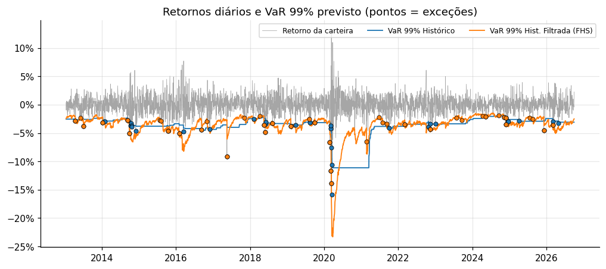
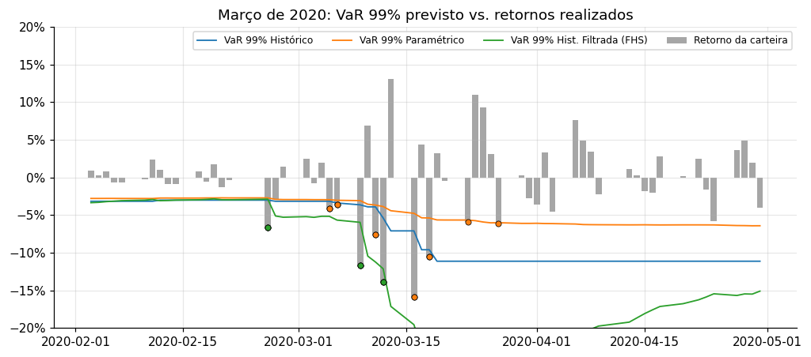
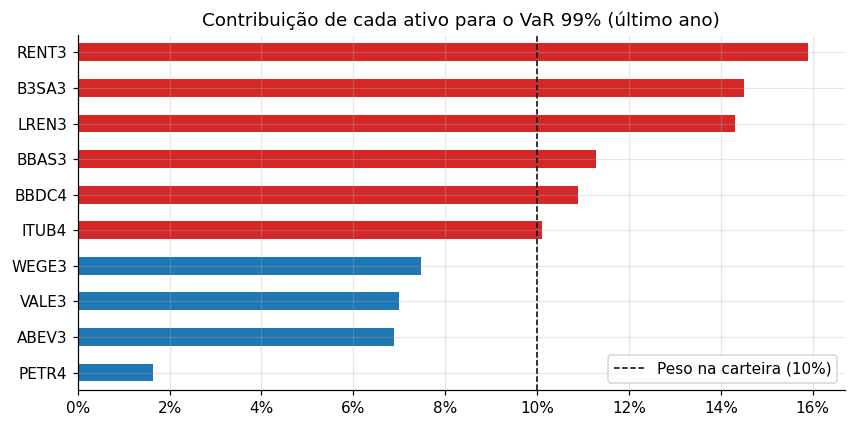
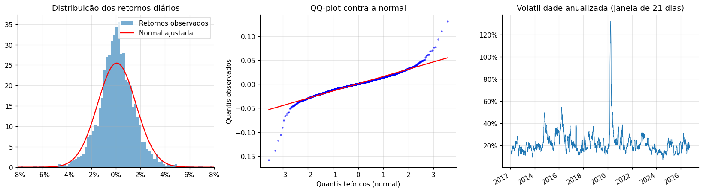

# Risco de Mercado de uma Carteira de Ações da B3

Implementação e **backtesting fora da amostra** de seis metodologias de Value at Risk (VaR) e
Expected Shortfall (CVaR) para uma carteira de 10 ações do Ibovespa, de 2012 a 2026, com
validação pelos testes de **Kupiec**, **Christoffersen** e pelo **semáforo de Basileia**.

**Stack:** Python · NumPy · Pandas · SciPy · Matplotlib · pytest

📓 **[Abrir o notebook com a análise completa](notebooks/analise_risco.ipynb)**

---

## Pergunta

Qual modelo de VaR prevê de forma confiável a perda diária de uma carteira de ações brasileiras,
inclusive em crises como a de março de 2020?

## Resultado do backtest (VaR 99%, 1 dia, 3.400 dias úteis)

| Modelo | Exceções | Esperado | Kupiec p-valor | Christoffersen p-valor | Basileia (últ. 250d) | Exceções na Covid* |
|---|---:|---:|---:|---:|:---:|---:|
| Histórico | 52 | 34 | 0,004 ❌ | 0,001 ❌ | Verde | 8 |
| Paramétrico (normal) | 53 | 34 | 0,002 ❌ | 0,000 ❌ | Amarela | 10 |
| Monte Carlo (normal multivariada) | 54 | 34 | 0,001 ❌ | 0,000 ❌ | Amarela | 10 |
| Cornish-Fisher | 42 | 34 | 0,184 ✅ | 0,111 ✅ | Verde | 5 |
| EWMA (RiskMetrics, λ = 0,94) | 49 | 34 | 0,015 ❌ | 0,738 ✅ | Verde | 4 |
| **Simulação Histórica Filtrada** | **42** | **34** | **0,184 ✅** | **0,548 ✅** | **Verde** | **3** |

<sub>*Exceções entre 20/02 e 31/03/2020. p-valor < 5% rejeita o modelo. Cada previsão usa apenas os 252 dias anteriores.</sub>



## Principais conclusões

1. **A normal subestima a cauda.** O VaR 99% normal é parecido com o histórico, mas o CVaR 99% normal fica
   **28% abaixo** do observado (4,1% contra 5,7%).
2. **Modelos com janela fixa falham em clusters.** Histórico, paramétrico e Monte Carlo erram mais do que deveriam e
   erram justamente nas crises, o que o teste de Christoffersen detecta.
3. **Efeito fantasma:** depois de março/2020, o VaR histórico ficou em ~11% por um ano inteiro, até a crise
   sair da janela de estimação.
4. **A Simulação Histórica Filtrada (FHS) foi o melhor modelo:** combina as caudas empíricas do método histórico
   com a volatilidade condicional do EWMA. É aprovada nos dois testes e teve só 3 exceções no auge da pandemia.



## O que foi implementado

| Módulo | Conteúdo |
|---|---|
| [`var.py`](src/marketrisk/var.py) | VaR/CVaR histórico, paramétrico, Cornish-Fisher, EWMA, Monte Carlo (normal e t-Student multivariada via Cholesky), Simulação Histórica Filtrada, Component VaR (decomposição de Euler) e previsão rolante sem *look-ahead* |
| [`backtest.py`](src/marketrisk/backtest.py) | Teste POF de Kupiec, teste de independência de Christoffersen, semáforo de Basileia |
| [`data.py`](src/marketrisk/data.py) | Download de preços ajustados (Yahoo Finance) com cache local e limpeza de feriados |
| [`tests/`](tests/test_marketrisk.py) | 18 testes que validam os modelos contra resultados analíticos conhecidos |

### Decomposição do risco

Pesos iguais não significam riscos iguais: RENT3, B3SA3 e LREN3 respondem por ~45% do VaR com 30% do capital.



### Fatos estilizados dos retornos

Caudas pesadas (excesso de curtose ≈ 9,5), assimetria negativa e clusters de volatilidade, que explicam
por que os modelos simples falham.



## Como reproduzir

```bash
git clone https://github.com/JPGonzalez-Quant/b3-market-risk.git
cd b3-market-risk
pip install -r requirements.txt
pytest                                   # 18 testes
jupyter notebook notebooks/analise_risco.ipynb
```

Os preços são baixados do Yahoo Finance na primeira execução e ficam em cache na pasta `data/`.

## Carteira

PETR4, VALE3, ITUB4, BBDC4, BBAS3, ABEV3, WEGE3, B3SA3, RENT3 e LREN3, com 10% em cada ativo
(rebalanceamento diário). Preços ajustados por proventos, de jan/2012 a set/2026.

## Próximos passos

- GARCH(1,1) com inovações t-Student
- VaR de 10 dias (horizonte regulatório) e Expected Shortfall 97,5% (FRTB)
- Testes de estresse com cenários históricos brasileiros (Joesley Day, greve dos caminhoneiros)

## Referências

- Jorion, P. *Value at Risk: The New Benchmark for Managing Financial Risk*. McGraw-Hill.
- Kupiec, P. (1995). Techniques for verifying the accuracy of risk measurement models. *Journal of Derivatives*.
- Christoffersen, P. (1998). Evaluating interval forecasts. *International Economic Review*.
- Barone-Adesi, G., Giannopoulos, K. & Vosper, L. (1999). VaR without correlations for portfolios of derivative securities. *Journal of Futures Markets*.

---

**Autor:** João Pedro Gonzalez · Físico (UNICAMP) · [LinkedIn](www.linkedin.com/in/jpgonzalez-quant)
